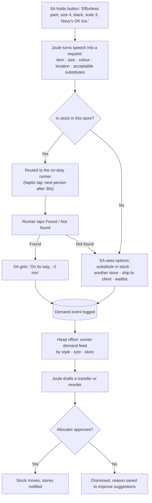

# Voice concept deep dive

Oct 19. Working name: **Joule Floor**, a voice-first assistant for store staff, built on SAP Joule. Source IDs refer to [research/sources.md](../research/sources.md). Tags: **[I]** interviews, **[P]** public source, **[A]** our assumption.

## Decision (Oct 20)

**Direction locked.** Problem: **slow, unreliable communication on the store floor.** Solution: **targeted voice requests built on SAP Joule's new voice capability, with every request feeding SAP Business Data Cloud.**

**Update (Oct 20, Cherry): earpiece-only, no phone app.** Aritzia's floor culture is "hands busy", so the product lives in a company earpiece with a push-to-talk button, picked up at clock-in. Confirmation and status are spoken, not shown on a screen; CMT stays the system of record. The problem statement leads with money: **inefficient floor communication costs Aritzia sales now and margin later.** Where this doc says "phone", "app", "haptic" or "tap", read "earpiece" and "spoken". See [pitch/one-pager.md](../pitch/one-pager.md).

## Problem framing

> Slow, unreliable communication on the store floor means two kinds of demand go unanswered: the client waiting in the fitting room now, and the pattern head office never sees because unmet requests are never recorded. We fix both with targeted voice requests on SAP's new Joule voice, feeding every request into SAP Business Data Cloud.

- **User problem (evidence: interviews):** requests send no notifications; staff refresh constantly; at peak they skip the tool and shout [I].
- **Business problem (evidence: industry data + our inference):** slow hand-offs contribute to lost sales on the floor, and unmet requests never reach planning. Say "contributes to", not "causes": the loss is our inference [A]; the 52% / $1.7T figures are industry-wide [S4, S6].

## Positioning

> **SAP built the voice. We give it its first retail job, and turn every spoken request into demand data SAP's planning tools have never seen.**

Voice is the input method, not the product. The value is: the request reaches the right person, they confirm, and demand that went unmet becomes data.

## One line

A Style Advisor says what the client needs; the right teammate gets it, and every request, filled or not, becomes demand data head office can act on the same day.

## The problem, in one scene

A client in a fitting suite wants the pants in a size 4, in black. Today the Style Advisor:
1. stops serving the client, takes out their phone, types the request into CMT [I];
2. waits, with no idea whether anyone saw it (no notifications) [I];
3. at peak, gives up on the app and shouts across the floor instead [I].

If the size isn't there, the client leaves without it and **no system records that the demand existed** (sales data only sees what sold). Head office finds out the style is hot only when weekly sell-through shows it sold out.

## Why voice

| Reason | Evidence |
|---|---|
| Staff hands are full (bundles, clients) and eyes should stay on the client | "prepping, running, and retrieving all while holding bundles and supporting clients" [I]; "keep hands busy" culture [I] |
| Staff asked for it | J1 suggested voice notes and speech-to-text search [I] |
| Proven on the retail floor | Walmart Ask Sam: 900k associates, 3M+ questions a week, ~98% answered [S28]. Theatro voice wearables at Neiman Marcus Last Call and The Container Store; ~12% associate time saved reported [S29] |
| SAP is shipping the platform | Joule Work mobile app takes voice input; real-time voice via LiveKit announced at Sapphire, May 2026; early adopters now, **GA planned H2 2026**; SAP names frontline workers as the target [S30] |
| Voice captures what typing skips | Spoken requests carry the details that matter for demand ("any colour is fine", "she needs it for Saturday") that nobody types into a form [A] |

## Users

| User | Role | What they get |
|---|---|---|
| **Requester** (primary) | Style Advisor (SA), Atelier Sales (AS) | Request by voice in 3 seconds; know when it's coming |
| **Runner** | Atelier Operations (AO), Boutique Associate (BA) | One clear queue; only their requests; where to find the item |
| **Store manager** | | Live view of floor load; who's swamped |
| **Allocator / merchant** (head office) | | Daily feed of unmet demand by style, size, store; suggested transfers to approve |

## Core flow

"Not found" when the system says it's in stock also corrects the store's inventory count, which helps online orders too (see [omni-problems.md](../research/omni-problems.md)).

## Features, ranked

| Priority | Feature | Pain it fixes | Evidence |
|---|---|---|---|
| **MVP 1** | **Targeted voice requests**: push-to-talk; AI turns speech into a structured request (item, size, colour, location, substitutes) and sends it **only** to the right person (by name, by role, or auto-assigned) | Typing while serving; broadcast noise; skipped at peak | [I] |
| **MVP 2** | **Acknowledgement and status**: "Dora's on it" → on its way → found / not found; haptic alerts, on-shift only, 30s escalation | No notifications; constant refreshing; going back to shouting | [I], [cmt-notifications.md](../research/cmt-notifications.md) |
| **MVP 3** | **Request data → SAP Business Data Cloud**, with a simple head-office view of unmet demand and AI-drafted transfers that a person approves | Unmet demand invisible to head office; slow response to demand shifts | [A] |
| Next | Not-found options: substitutes, other store, ship-to-client, waitlist | Lost sales | [A] |
| Next | "Not found but system says in stock" → inventory correction | Phantom stock, failed online orders | [I] |
| Later | Fitting-room signal (tried on, didn't buy, why) | Wrong size mix, markdowns | [product-ideas.md](../research/product-ideas.md) B |
| Later | Multilingual; smartwatch / earbud | Diverse teams; fully hands-free | [A] |

**Deliberately not in scope:** voice for customers, voice checkout, always-on listening, replacing CMT entirely.

## Targeted routing

| You say | Who gets it | If they can't take it |
|---|---|---|
| "**Dora**, can you grab the Effortless pant in a 4?" | Dora only | Busy, on break or off shift → next person in her role; sender is told who's taking it |
| "**Any runner**, size 4 black…" | Best available person in that role (free, closest, on shift) | Next person if not accepted in ~30s |
| No name ("Effortless pant, 4, black, suite 3") | AI picks based on request type | Same as above |

- Two people with the same name: ask once, then remember who you usually work with.
- Only on-shift staff are reachable (labour-law reasons in [cmt-notifications.md](../research/cmt-notifications.md)).
- The sender always gets an acknowledgement. Without it, people go back to shouting.
- **Differentiation:** calling by name exists elsewhere (e.g. Theatro). Ours is the combination: role- and availability-aware routing + spoken request turned into structured data + data flowing into SAP.
- **To verify:** do Aritzia stores use radios or earpieces today (a broadcast channel)? Dora's notes don't say.

## Data captured → SAP Business Data Cloud

| Captured from each request | Who uses it | What they do |
|---|---|---|
| Item, size, colour, store, time | Allocators | See in-store demand, including requests that never became sales |
| Outcome: found, not found, substitute accepted, sold | Allocators, buyers | Move stock between stores or reorder; fix size mix |
| "Not found" when the system says in stock | Store managers, inventory team | Correct stock counts (also fixes failed online orders) |
| Request volume and time to fulfil, by hour | Store managers | Staff busy hours ("feels like 3 people required, 1 scheduled" [I]) |

## Voice design rules

1. **Push-to-talk, never always listening.** Protects client privacy, avoids picking up conversations, and cuts errors from store noise. Speech recognition accuracy drops sharply in noise: one benchmark puts error rates at 6% in a quiet room and 30%+ on a warehouse floor [S31].
2. **Fill slots, then confirm.** Joule extracts item, size, colour and location, and shows a one-line confirmation card ("Effortless Pant · 4 · Black · Suite 3 · Navy OK"). One tap to fix anything it got wrong.
3. **Short phrases work.** Staff can say "four black effortless suite three" and it still works.
4. **Always a tap fallback.** If voice fails twice, show the form pre-filled with what it heard.
5. **Keep the text, not the audio.** Transcribe and discard recordings; only the structured request is stored.
6. **Earbud or lapel mic recommended** in loud stores (later phase).

## Where AI acts and where people decide

| Step | AI | Person |
|---|---|---|
| Understanding the request | Transcribes and structures it | Confirms or corrects in one tap |
| Routing | Picks the on-duty runner; escalates if no response | Runner accepts; manager can reassign |
| Substitutes | Suggests in-stock alternatives | SA and client choose |
| Demand signal | Groups requests, filters noise, spots spikes | — |
| Transfers / reorders | Drafts the move with the evidence behind it | **Allocator approves every move** |

Rule: **AI never moves inventory or changes orders on its own.** It drafts, a person approves. This answers the case's question about human oversight.

## How it fits SAP

**Value to SAP:**
- **Adoption:** a ready-made frontline use case for Joule Work voice in retail, one of SAP's biggest industries.
- **New data:** unmet-demand data for Retail Intelligence that sales-only competitors can't see.
- **Expansion and migration:** standard support for SAP ECC (EHP 6–8) ends **Dec 31, 2027**; extended support to 2030 costs extra [S32]. Aritzia's known SAP system is ECC, upgraded to EHP7 [S11]. "Move to S/4HANA / SAP cloud and your store floor gets voice and demand capture" is a reason to choose SAP's cloud over a competitor's.

**Roadmap:** pilot in a few stores via SAP Early Adopter Care (voice in early access now) → scale after Joule Work voice GA (H2 2026) [S30].

**Components (assumptions to validate):**

| Layer | SAP component |
|---|---|
| Voice and conversation | Joule Work mobile app with LiveKit real-time voice [S30] |
| Notifications | SAP Mobile Start push notifications [S24] |
| On-shift status | Time and scheduling data (e.g. SuccessFactors or the retailer's workforce system) [A] |
| Stock and items | S/4HANA for Fashion and Vertical Business [S13] |
| Demand data | Customer Activity Repository → Unified Demand Forecast, Retail Intelligence [S2, S14] |
| Build | SAP BTP / Joule Studio agents [A] |

**Why SAP, not a startup:** the signal is only valuable if it flows straight into the forecasting and allocation systems the retailer already runs on SAP. A standalone voice app (Theatro, Tulip) can capture requests but can't close the loop to allocation. [A]

**Why SAP hasn't built it:** SAP's retail AI learns from transactions (sales, orders). A request that never became a sale is not a transaction, so it never enters the data. [A]

## Success metrics

| Metric | Measures | Target (assumption) |
|---|---|---|
| Request capture rate | Share of floor requests logged (vs shouted) | >80% at peak |
| Time to retrieve | Request to item in hand | −50% |
| Unmet demand captured | Not-found requests logged per store per week | Baseline in pilot |
| Substitute / recovery rate | Unmet requests that still end in a sale | Baseline in pilot |
| Head-office time to act | Demand spike to approved transfer | Days instead of weeks |
| Staff adoption | Weekly active SAs and runners | >70% |

## Risks

| Risk | Mitigation |
|---|---|
| Noise breaks recognition | Push-to-talk, short phrases, confirm card, tap fallback, earbuds later |
| Clients feel recorded | Push-to-talk only, audio discarded, staff-only speech |
| Staff skip it at peak again | Must be faster than shouting; test in pilot with stopwatch |
| Off-shift labour risk | On-shift only, tied to clock-in |
| Signal is noisy (one client asks five times) | Group by session; allocator sees evidence, approves every move |
| Inventory data is wrong | "Not found" corrections improve it over time |
| Joule voice not GA until H2 2026 | Pilot on early-adopter program; tap-first MVP works without voice |

## Open questions to validate

- Would SAs actually talk to their phone in front of a client? (Ask Dora's group.)
- Is a not-found request ever recorded today? Does head office ever see it?
- How does allocation decide transfers today, and how often?
- How loud is a busy Aritzia store, and do staff wear earpieces already?

## Video moment (idea)

Split screen. Left: today, an SA juggling bundles, typing, refreshing, then shouting. Right: SA says one sentence, the runner's watch taps, the item arrives; cut to head office where a map lights up with "size 4 black requested 47× this week, 0 in stock" and an allocator taps Approve.
